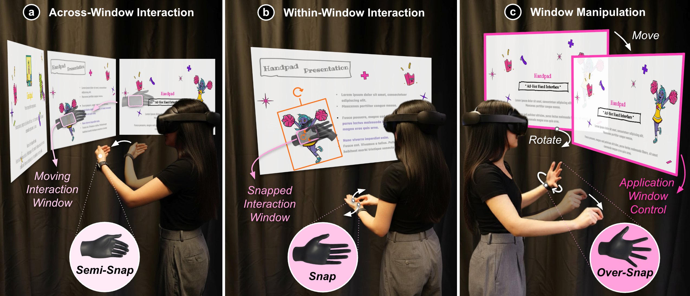
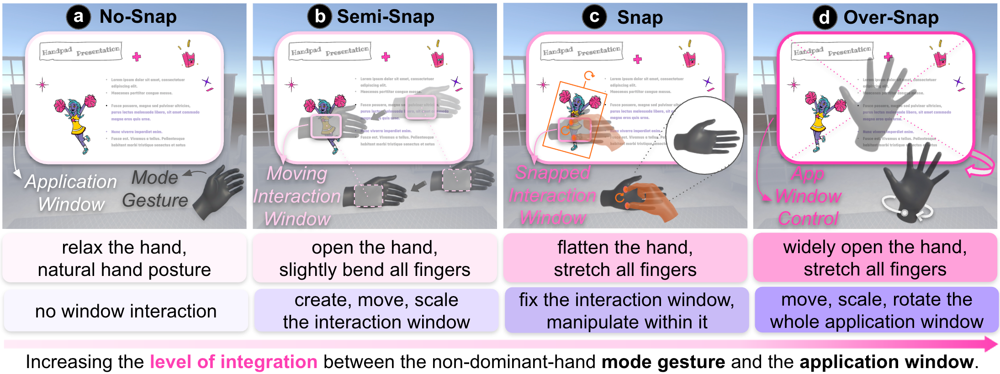

# HandPad

**HandPad: A Bimanual Hand Interface for Fluid Window Interactions in VR**

**Wen Ying¹, Adil Rahman¹, Erzhen Hu¹, and Seongkook Heo²**

¹ Department of Computer Science, University of Virginia  
² Department of Computer Science and Engineering, Ulsan National Institute of Science and Technology (UNIST)

**Accepted at ACM ISS 2026 · Publication forthcoming**

[Paper PDF](media/HandPad.pdf) · [Assigned DOI: 10.1145/3859332](https://doi.org/10.1145/3859332) · [Demo video (MP4, 2:50)](media/HandPad-demo.mp4)

HandPad is a research prototype for bare-hand interaction with multiple 2D windows in VR. The non-dominant hand establishes a spatial frame, selects the interaction context, and provides a self-haptic touch surface. The dominant hand performs on-hand touch and complementary mid-air manipulation. Hand remapping connects the physical hands to virtual windows so interaction is not constrained by window location.

## Interaction modes

| Mode | Role |
| --- | --- |
| No-Snap | Relaxed hand posture; no window interaction |
| Semi-Snap | Establish and move the interaction window for cross-window navigation |
| Snap | Fix the interaction window and manipulate content through palm-based touch and dominant-hand gestures |
| Over-Snap | Manage application windows through non-dominant-hand posture and dominant-hand pinch gestures |

The [demo video](media/HandPad-demo.mp4) shows the interaction workflow.

The historical name **VRSnap** remains in code and serialized values for compatibility.

## Getting started

1. Follow [Setup](docs/SETUP.md) to install the web server and separately licensed Unity dependencies.
2. Start Flask on the same PC as Unity. Preview the [quiz](http://127.0.0.1:5000/quiz), [poster canvas](http://127.0.0.1:5000/canvas2), and [tutorial](http://127.0.0.1:5000/tutorial).
3. Open `unity/` in Unity **2022.3.22f1**. Start with `HandGestureTutorialScene`, then `HandGestureScene`.

This is a PC-hosted prototype using a Meta Quest Pro with hand tracking. External images and CDN scripts require internet access.

## Repository

| Directory | Contents |
| --- | --- |
| `unity/` | Four HandPad scenes, shared controllers, assets, and the exported touch model |
| `web/` | Flask quiz, poster, source pages, map, and tutorial |
| `tests/` | Standalone C# touch-buffer regression harness |
| `docs/` | Setup instructions and external-media attribution |
| `media/` | Paper PDF, overview figures, and demonstration video |

## License

Project-owned code and the team-authored model use the [MIT license](LICENSE). Third-party components and external media retain their own terms; see [Third-party notices](THIRD_PARTY_NOTICES.md). Vuplex and Syncfusion must be installed separately under valid licenses.

The paper and figures retain the publication's license and any third-party credit lines.

## Citation

The assigned issue is November 2026; publication is forthcoming.
